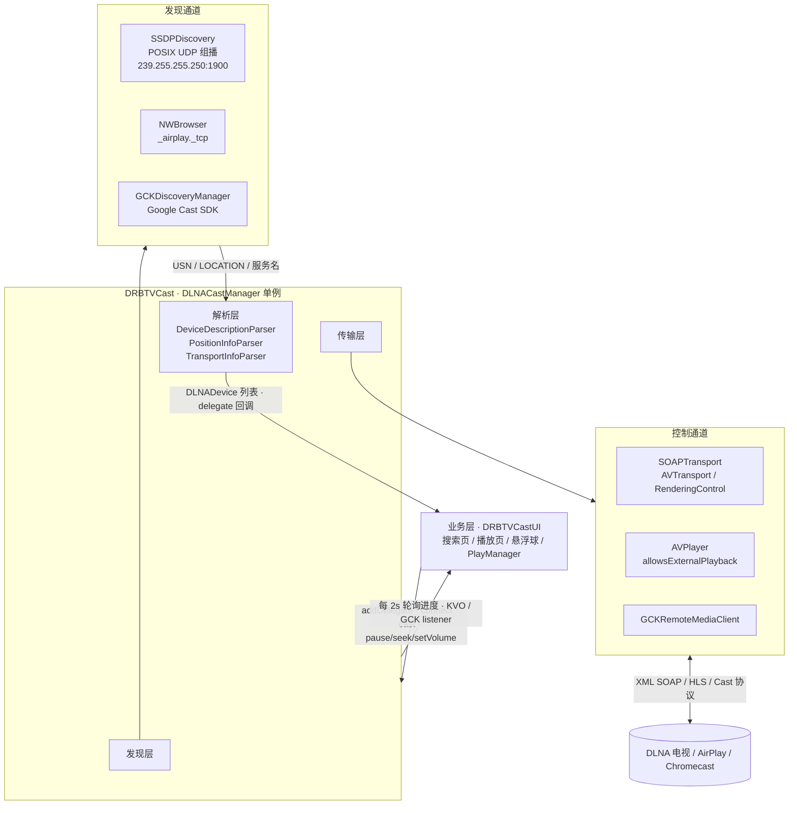
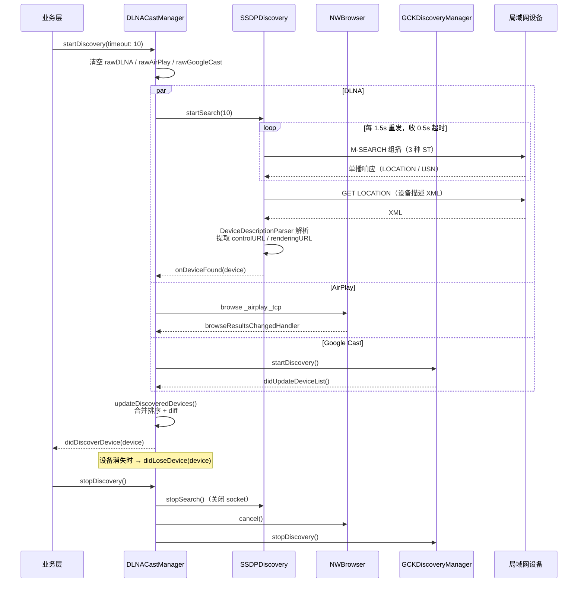
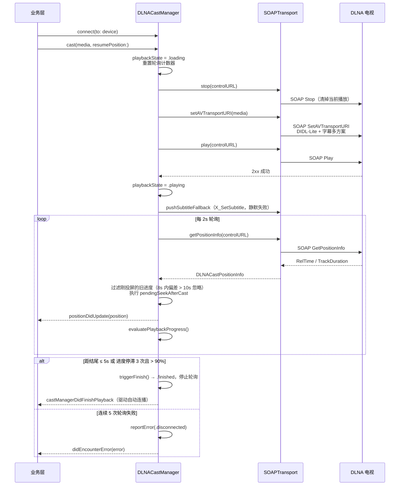
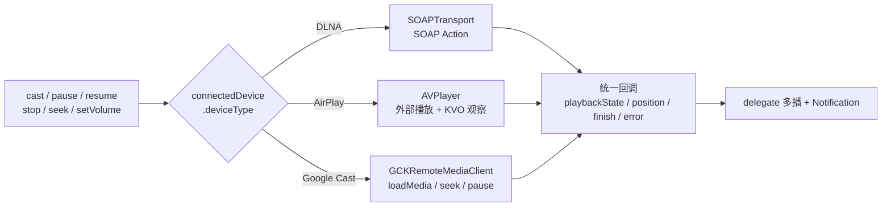

# DRBTVCast

DramaBox 投屏模块的本地 Pod 仓库，包含底层投屏能力库 `DRBTVCast` 与投屏业务 UI 层 `DRBTVCastUI`。

## 模块

| 模块 | 说明 |
| --- | --- |
| `DRBTVCast` | 纯 Swift 投屏能力库，统一封装 DLNA / AirPlay / Google Cast 三种协议的设备发现、媒体投送、播放控制与进度轮询。 |
| `DRBTVCastUI` | 投屏业务 UI 层，包含搜索设备页、播放控制页与悬浮入口。源码由主工程归档而来，用于模块化恢复，依赖主工程的 `DRB*` 类型、本地化与资源，不能脱离主工程单独运行。 |

## 功能特性

- 三种投屏协议统一抽象：DLNA / AirPlay / Google Cast
- SSDP 组播设备发现（POSIX UDP socket），自动解析设备描述并提取 AVTransport / RenderingControl 控制地址
- Bonjour（`_airplay._tcp`）发现 AirPlay 设备，Google Cast 通过官方 SDK 发现
- 投送媒体：支持标题、集数、外挂字幕（SRT / VTT / ASS）
- 播放控制：播放 / 暂停 / 停止 / 跳转 / 倍速 / 音量
- 进度轮询与播放完成检测，通过 delegate 回调驱动自动连播
- 多 delegate 弱引用广播，状态变更同时发送 Notification
- 字幕多方案兼容：DIDL-Lite `<res>`、Samsung `sec:CaptionInfo*`、非标准 `X_SetSubtitle`

## 架构与时序

### 架构原理图



### 设备发现时序图



### DLNA 投屏播放时序图



### 三协议控制分发



说明要点：

- 设备发现结果按 `priority` 排序：Google Cast(3) > DLNA(2) > AirPlay(1)。
- Google Cast 会话未就绪时投屏请求缓存在 `pendingMediaToCast`，`didStart session` 后再发出。
- AirPlay 连接唤起系统 `AVRoutePickerView`，播放完成依赖 `AVPlayerItemDidPlayToEndTime` 通知，断连检测依赖 `isExternalPlaybackActive` KVO。

## 环境要求

- iOS 15.1+
- Swift 5.0 / 6.0

## 集成

### Swift Package Manager（SPM）

仓库根目录包含 `Package.swift`，Xcode 中依次选择 **File → Add Package Dependencies…**，输入本地仓库路径添加，或在 `Package.swift` 中声明：

```swift
dependencies: [
    .package(path: "../LocalPod/DRBTVCast")
],
targets: [
    .target(
        name: "YourApp",
        dependencies: [
            .product(name: "DRBTVCast", package: "DRBTVCast")
        ]
    )
]
```

SPM 方式会自动解析 Google Cast SDK（`googlecast/google-cast-ios-sdk`，`GoogleCastDynamic`，4.8.6+）。

> **注意**：SPM 仅提供核心库 `DRBTVCast`。`DRBTVCastUI` 依赖主工程的 `DRB*` 私有符号与资源，无法独立编译，请通过 CocoaPods 或源码方式集成。

### CocoaPods

在 `Podfile` 中使用本地路径依赖：

```ruby
pod 'DRBTVCast', :path => '../LocalPod/DRBTVCast'

# 仅在需要投屏 UI 层时引入
pod 'DRBTVCastUI', :path => '../LocalPod/DRBTVCast'
```

依赖关系：

- `DRBTVCast` → `google-cast-sdk`
- `DRBTVCastUI` → `DRBTVCast`、`SnapKit`、`ObjectMapper`

## 快速使用

```swift
import DRBTVCast

// 1. 初始化 Google Cast（可选，按需调用，全局只需一次）
DLNACastManager.shared.initializeGoogleCast()

// 2. 注册回调监听
DLNACastManager.shared.addDelegate(self)

// 3. 搜索局域网设备
DLNACastManager.shared.startDiscovery(timeout: 10)

// 4. 连接目标设备
DLNACastManager.shared.connect(to: device)

// 5. 投送媒体
let media = DLNACastMediaInfo(
    mediaURL: "https://example.com/video.m3u8",
    title: "剧名",
    episode: 1,
    subtitleURL: "https://example.com/subtitle.srt",
    subtitleType: .srt
)
DLNACastManager.shared.cast(media: media, resumePosition: 0)

// 6. 播放控制
DLNACastManager.shared.pause()
DLNACastManager.shared.resume()
DLNACastManager.shared.seek(to: 60)
DLNACastManager.shared.setVolume(0.8)

// 7. 结束投屏
DLNACastManager.shared.disconnect()
```

实现 `DLNACastManagerDelegate` 接收设备发现 / 丢失、播放状态变化、进度更新、播放完成与错误回调。

## 目录结构

```
DRBTVCast/
├── DRBTVCast/
│   └── Classes/              # 核心投屏库源码（DRBTVCast.podspec 的 source_files）
├── DRBTVCastUI/
│   ├── Controller/           # 投屏控制器
│   ├── Model/                # 业务模型与管理器
│   ├── View/                 # 自定义视图
│   ├── Resources/            # 图片、JSON、本地化字符串
│   └── DRBTVCastUI.podspec
├── DRBTVCast.podspec
└── LICENSE
```

本地 Demo 工程（`DRBCastDemo/`、`DRBTVCastUI/DRBTVCastUIDemo/`）及其依赖、调试文件不纳入版本管理，详见 `.gitignore`。

## 许可证

MIT License，详见 [LICENSE](LICENSE)。
